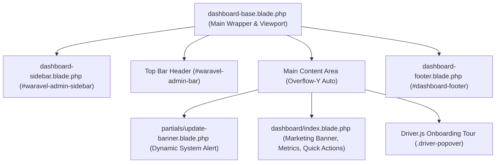

<div class="guide-banner guide-banner-dev"><span>🛠️</span> Developer Guide: Technical Reference</div>

# Dashboard API, Blade Architecture & Internal Lifecycle

The **Waravel Dashboard** (`/waravel` or `/admin/dashboard`) is the central nerve center for administrative operations. Built upon modular Blade templates, Tailwind CSS, Alpine.js, and Driver.js, it provides developers with clear extension points to register custom cards, compute telemetry metrics, and hook into administrative workflows.

---

## 🏛️ 1. Blade Component & Layout Structure

The dashboard interface is mounted through a layered Blade layout architecture located in `sobberrc/waravel/resources/views/`:



### Key Template Responsibilities

* **`dashboard-base.blade.php`:**
  * Defines viewport metadata, silences unneeded CDN warnings, and loads dependencies (Tailwind, Alpine.js Collapse plugin, Alpine core, FontAwesome 6).
  * Injects the persistent fixed `#waravel-admin-sidebar` (width `220px`) and responsive `#waravel-admin-bar` (height `55px`).
  * Yields `@yield('content')` wrapped in an inner scrolling container (`overflow-y: auto`).
* **`dashboard-sidebar.blade.php`:**
  * Contains the brand logo link (`route('waravel')`) and structured navigation groups: **Main** (Dashboard, Marketplace), **Content** (Pages, Media, Tags), **Appearance** (Themes, Menus, Theme Customizer, Layout Studio, Widget Editor), and **Tools** (Plugins, Integrations).
* **`dashboard/index.blade.php`:**
  * Renders the FileGuard Security Suite hero banner, Summer Vibe Welcome card (`#tour-welcome-banner`), dynamic Recent Activities snap container (`#recent-activity-container`), and Quick Action cards for Pages, Media, and Settings.
  * Embeds the interactive 9-step **Driver.js** onboarding tour engine.

---

## 📊 2. Metrics Card Calculation & Data Flow

Dashboard status indicators and summary metrics are dynamically computed during the request lifecycle. 

Inside `waravel::dashboard.index`, real-time tools counts are resolved using schema-safe queries:

```php
// Dynamic resolution of active plugins and platform integrations
$dynamicPluginsCount = 0;
$dynamicIntegrationsCount = 0;

try {
    if (\Illuminate\Support\Facades\Schema::hasTable('waravel_plugins')) {
        $dynamicPluginsCount = \Illuminate\Support\Facades\DB::table('waravel_plugins')
            ->where('active', 1)
            ->count();
    }
} catch (\Throwable $e) {}

try {
    if (\Illuminate\Support\Facades\Schema::hasTable('waravel_integrations')) {
        $dynamicIntegrationsCount = \Illuminate\Support\Facades\DB::table('waravel_integrations')
            ->where('is_active', 1)
            ->count();
            
        // Fallback if is_active column is unset
        if ($dynamicIntegrationsCount === 0) {
            $dynamicIntegrationsCount = \Illuminate\Support\Facades\DB::table('waravel_integrations')->count();
        }
    }
} catch (\Throwable $e) {}
```

### Global View Composers (`WaravelServiceProvider`)

Global notification counters across the sidebar and top bar are automatically shared via Laravel View Composers:

```php
\Illuminate\Support\Facades\View::composer([
    'waravel::layouts.dashboard-layouts.dashboard-sidebar',
    'waravel::layouts.dashboard-layouts.dashboard-base'
], function ($view) {
    $updateService = app(\Sobberrc\Waravel\Services\UpdateService::class);
    $isOutdated = $updateService->isOutdated();
    
    $pendingPluginUpdates = count($updateService->getPluginUpdates());
    $pendingThemeUpdates = count($updateService->getThemeUpdates());
    $updateCount = ($isOutdated ? 1 : 0) + $pendingPluginUpdates + $pendingThemeUpdates;
    
    $newMarketplaceItems = $updateService->getNewMarketplaceItemsCount();

    $view->with([
        'coreOutdated' => $isOutdated,
        'latestCoreInfo' => $isOutdated ? $updateService->getLatestVersion() : null,
        'pendingPluginUpdates' => $pendingPluginUpdates,
        'pendingThemeUpdates' => $pendingThemeUpdates,
        'updateCount' => $updateCount,
        'newMarketplaceItems' => $newMarketplaceItems
    ]);
});
```

---

## 🧭 3. Driver.js Tour Guide Integration

The 9-step interactive walkthrough uses Driver.js (`v1.3.1`) initialized client-side:

```javascript
document.addEventListener('DOMContentLoaded', function() {
    if (localStorage.getItem('waravel_dashboard_tour_dismissed') !== 'true') {
        const driver = window.driver.js.driver;
        
        const tourObj = driver({
            showProgress: true,
            animate: true,
            allowClose: true,
            doneBtnText: 'Finish',
            closeBtnText: 'Close',
            nextBtnText: 'Next &rarr;',
            prevBtnText: '&larr; Prev',
            onPopoverRender: (popover, { config, state }) => {
                // Injects "Don't show again" checkbox in popover footer
            },
            onDestroyStarted: () => {
                tourObj.destroy();
                showTourToast(); // Shows floating bottom toast pill
            },
            steps: dynamicSteps
        });
        
        setTimeout(() => tourObj.drive(), 800);
    }
});
```

### Toast Notification Lifecycle (`#waravel-tour-toast`)
When the tour modal closes, an in-DOM toast is injected into `document.body`:
* Includes a **Reopen** button to re-trigger `tourObj.drive()`.
* Automatically slides in using CSS transitions: `transform: translateX(-50%) translateY(0)`.
* Auto-dismisses after 12 seconds or when the close button (`&times;`) is pressed.

---

## 🔌 4. Widget Registry & Layout Studio Architecture

Custom widgets are registered into the `WidgetManager` service during the service provider boot cycle:

```php
namespace App\Providers;

use Illuminate\Support\ServiceProvider;
use Sobberrc\Waravel\Services\WidgetManager;
use App\Waravel\Widgets\CustomMetricsWidget;

class WaravelCustomizationServiceProvider extends ServiceProvider
{
    public function boot(WidgetManager $widgetManager)
    {
        // Register custom dashboard or frontend widget
        $widgetManager->register('metrics_summary', CustomMetricsWidget::class);
    }
}
```

Widgets implement standard rendering methods:
* **`render()`:** Outputs processed HTML/Blade content into dynamic template slots (`@widgetZone('header-main-left')`).
* **`settings()`:** Declares user-configurable schema options editable via the **Widget Editor** (`/waravel/widgets`).
