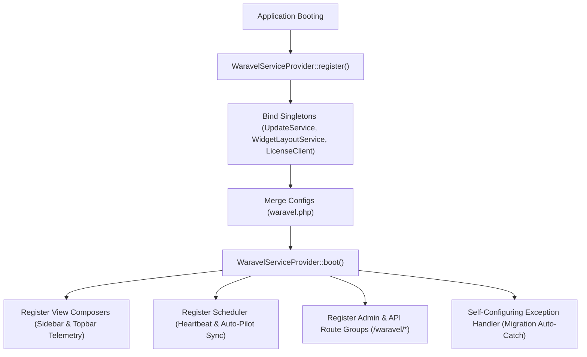
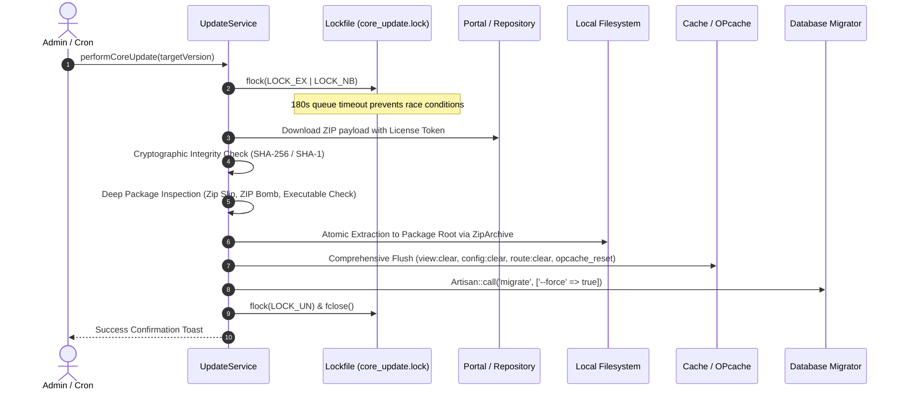

<div class="guide-banner guide-banner-dev"><span>🛠️</span> Developer Guide: Technical Reference</div>

# Infrastructure, Service Providers & Core Lifecycle

The Waravel Core package (`sobberrc/waravel`) serves as the infrastructural bridge connecting Laravel’s enterprise backend capabilities with high-speed CMS operations.

---

## 🏛️ 1. The Core Lifecycle & Service Booting

The initialization sequence begins in `Sobberrc\Waravel\WaravelServiceProvider`:



---

## ⚡ 2. The Auto-Update Staging Pipeline

Waravel's update engine (`Sobberrc\Waravel\Services\UpdateService`) executes a safe, atomic, zero-downtime deployment process:



### Staging Pipeline Code Structure
Key stages in `UpdateService::performCoreUpdate()`:

```php
// 1. Process Concurrency Lock
$lockFile = storage_path('app/temp/core_updates/core_update.lock');
$lockHandle = fopen($lockFile, 'c+');
if (!flock($lockHandle, LOCK_EX | LOCK_NB)) {
    // Queue wait loop up to 180 seconds...
}

// 2. Cryptographic Checksum Verification
$actualHash = hash_file($algo, $zipFile);
if ($actualHash !== $expectedHash) {
    File::delete($zipFile);
    throw new SecurityException("Package hash mismatch! Update aborted.");
}

// 3. Deep ZIP Security Validation
$security = $this->validateZipSecurity($zipFile);
if (!$security['safe']) {
    File::delete($zipFile);
    throw new SecurityException($security['reason']);
}

// 4. Atomic Extraction to Core Package Root
$zip = new \ZipArchive();
if ($zip->open($zipFile) === TRUE) {
    $zip->extractTo($packageRoot);
    $zip->close();
}
```

---

## 🧹 3. Cache Purging, Route Maps & Tags

Waravel maintains high performance by isolating cache domains. When updates are deployed or when an administrator executes **Optimize Clear**:

```php
namespace Sobberrc\Waravel\Http\Controllers;

use Illuminate\Routing\Controller;
use Illuminate\Support\Facades\Artisan;
use Illuminate\Support\Facades\Cache;

class MaintenanceController extends Controller
{
    public function executePurge()
    {
        // 1. Flush framework compilation layers
        Artisan::call('config:clear');
        Artisan::call('route:clear');
        Artisan::call('view:clear');
        Artisan::call('cache:clear');
        
        // 2. Clear Waravel transient keys & marketplace manifests
        Cache::forget('waravel_latest_version_source');
        Cache::forget('waravel_marketplace_plugins_data');
        Cache::forget('waravel_marketplace_themes_data');
        Cache::forget('waravel_core_versions');
        Cache::forget('waravel_theme_updates');

        // 3. Reset PHP OPcache bytecode cache
        if (function_exists('opcache_reset')) {
            opcache_reset();
        }

        // 4. Restart Background Queue Workers
        Artisan::call('queue:restart');
    }
}
```

---

## ⏱️ 4. Cron Schedules & Heartbeat Diagnostics

Automated features run via Laravel’s Task Scheduler (`php artisan schedule:run`).

### Scheduler Registration (`WaravelServiceProvider`)

```php
$this->app->booted(function () {
    $schedule = $this->app->make(\Illuminate\Console\Scheduling\Schedule::class);

    // 1. Site Heartbeat Pulse — runs every minute
    $schedule->call(function () {
        \Illuminate\Support\Facades\DB::table('waravel_settings')->updateOrInsert(
            ['key' => 'waravel_last_heartbeat'],
            ['value' => now()->toDateTimeString(), 'updated_at' => now()]
        );
    })->everyMinute();

    // 2. Auto-Pilot Sync — hourly background update verification
    $schedule->command('waravel:auto-pilot-sync')
        ->hourly()
        ->withoutOverlapping()
        ->runInBackground();
});
```

### Self-Healing Error Handling
If a release includes a new database migration that has not yet run, Waravel intercepts query exceptions targeting dashboard routes (`MySQL error 1054` for unknown column or `1146` for missing table) and redirects gracefully to `/waravel/updates` with a prompt to click **Run Migrations**, preventing raw database stack traces from being shown to administrators.
