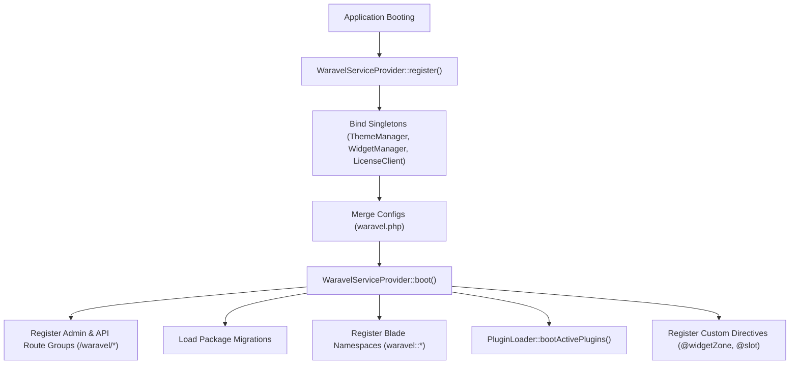

<div class="guide-banner guide-banner-dev"><span>🛠️</span> Developer Guide: Technical Reference</div>

# Infrastructure, Service Providers & Core Lifecycle

The Waravel Core package (`sobberrc/waravel`) serves as the infrastructural foundation that bridges native Laravel frameworks with visual CMS management.

---

## 1. The Core Service Provider (`WaravelServiceProvider`)

The lifecycle of Waravel begins inside `Sobberrc\Waravel\WaravelServiceProvider`:



---

## 2. Dynamic Plugin Discovery & Sandboxing

Plugins reside in the root `plugins/` directory. During the boot phase:
1. `PluginLoader::discover()` reads all subdirectories and parses `plugin.json` manifests.
2. It queries `Setting::get('active_plugins', [])` to determine enabled extensions.
3. For each active plugin, it instantiates the main plugin class (which extends `Sobberrc\Waravel\Plugins\AbstractPlugin`), boots its routes, registers its views, and runs any pending migrations.
4. **Sandboxing:** A fatal error in an unactivated plugin will not crash the host application.

---

## 3. Cache Invalidation & Global Purge (`optimize:clear`)

To maintain sub-100ms response times, Waravel caches route maps, view compilations, theme CSS variables, and widget outputs.

When a user triggers **Optimize Clear** from the Maintenance Center or CLI:
```php
namespace Sobberrc\Waravel\Http\Controllers;

use Illuminate\Support\Facades\Artisan;
use Illuminate\Support\Facades\Cache;

class MaintenanceController extends Controller
{
    public function optimizeClear()
    {
        // 1. Flush Laravel core caches
        Artisan::call('optimize:clear');
        
        // 2. Clear Waravel-specific tags and compiled skins
        Cache::tags(['waravel', 'widgets', 'themes'])->flush();
        
        // 3. Clear transient marketplace manifests
        Cache::forget('waravel_marketplace_index');
        
        return response()->json(['status' => 'success', 'message' => 'All caches cleared successfully.']);
    }
}
```

---

## 4. Background Scheduler Heartbeat

Automated features (Auto-Pilot core updates, Page Generator queues, and scheduled publishing) run through Laravel's Task Scheduler (`php artisan schedule:run`).

* **Heartbeat Verification:** Every run of the scheduler touches a timestamp record in `waravel_settings` (`last_scheduler_pulse`).
* **Health Check API:** The Top Bar queries `/waravel/api/heartbeat-status`. If `now()->diffInMinutes($lastPulse) > 15`, it flags the warning icon (**⚠️**) in the admin interface.
* **Cron Configuration:**
  ```bash
  * * * * * cd /path/to/project && php artisan schedule:run >> /dev/null 2>&1
  ```

---

## 5. Storage Symlink Architecture (`storage:link`)

Uploaded media files are stored in `storage/app/public/media/`. 
The application requires the standard symbolic link:
```bash
php artisan storage:link
```
This generates `public/storage` &rarr; `storage/app/public`, enabling LiteSpeed, Nginx, or Apache to serve images directly at raw web server speeds without booting the PHP application stack for asset requests.
