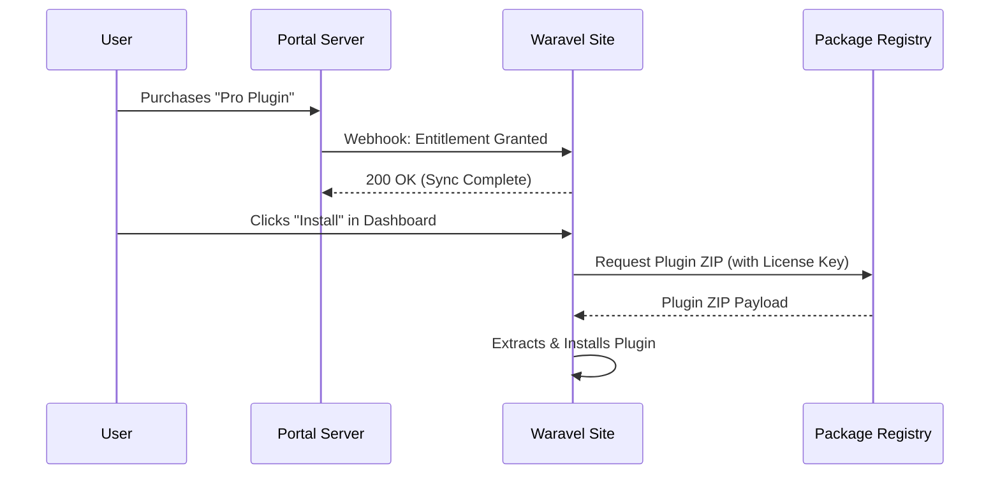

🛠️ Developer Guide: Technical Reference

# Ecosystem Architecture

> [!IMPORTANT]
> **Purpose of this Guide:** This developer guide is intended for advanced troubleshooting, understanding database schemas, and pushing the Waravel ecosystem to its absolute limits. It is **not** a guide for building and publishing third-party plugins to the public Waravel Marketplace, as the marketplace is currently curated and maintained by the core team.

The Waravel Ecosystem is divided into several interconnected components designed to provide a robust, scalable, and premium SaaS-like experience.

## The Three Pillars

1.  **Waravel Site (The Client)**
    This is the core package (`sobberrc/waravel`) installed on a user's local Laravel application. It provides the dashboard, theme engine, plugin loader, and connects to the marketplace.
2.  **Waravel Portal (The Server)**
    A centralized server that handles user accounts, subscriptions, license management, and webhook dispatching for entitlements.
3.  **Package Registry (The Distributor)**
    The infrastructure responsible for hosting plugin/theme ZIP files, managing versions, and delivering updates to client sites via the Auto-Pilot system.

## Communication Flow

When a user purchases a plugin on the Portal:
1.  The **Portal** registers the entitlement to the user's license key.
2.  A **Webhook** is fired from the Portal to the user's connected **Waravel Site**.
3.  The **Waravel Site** processes the webhook and updates its local `license_entitlements` record.
4.  The client site can now fetch and download the plugin from the **Package Registry**.

