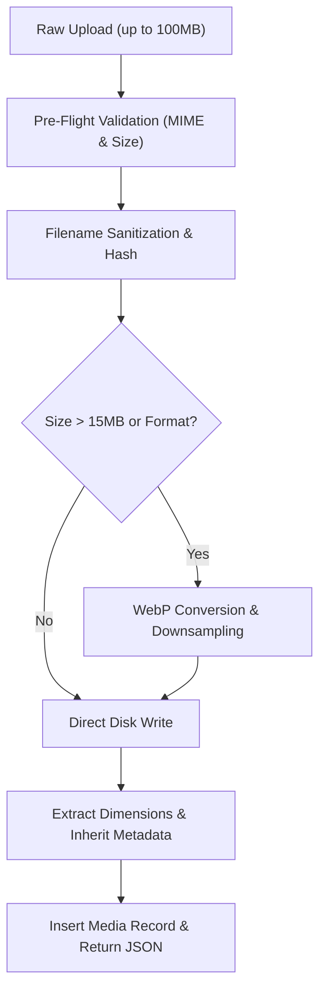

<div class="guide-banner guide-banner-dev"><span>⚙️</span> Developer Guide: Core Architecture</div>

# Media Vault Architecture & API Internals

The **Media Vault** in Waravel (`Sobberrc\Waravel\Models\Media`) is a high-throughput asset storage and optimization engine designed for zero-lag gallery rendering, automated metadata extraction, and polymorphic asset attachments.

---

## 🗄️ Database Schema (`media` Table)

The `media` table stores granular file metadata, dimensions, and SEO descriptors:

| Column | Type | Constraints / Modifiers | Description |
| :--- | :--- | :--- | :--- |
| `id` | `unsignedBigInteger` | `primaryKey`, `autoIncrement` | Unique media item record identifier. |
| `disk` | `string(50)` | `default('public')` | Laravel filesystem disk name (`public`, `s3`, `r2`). |
| `path` | `string(500)` | `not null` | Relative path on the storage disk (e.g. `uploads/2026/10/hero.webp`). |
| `filename` | `string(255)` | `not null` | Sanitized physical file name stored on disk. |
| `original_name`| `string(255)` | `not null` | Original uploaded file name prior to sanitization. |
| `file_extension`| `string(20)` | `not null`, `index` | File extension (`jpg`, `png`, `webp`, `svg`, `pdf`, `mp4`). |
| `mime_type` | `string(100)` | `not null`, `index` | Full MIME string (`image/webp`, `application/pdf`). |
| `file_size` | `unsignedBigInteger` | `not null` | File size in bytes. |
| `title` | `string(255)` | `nullable` | Human-readable asset title. Auto-inherited from filename. |
| `alt_text` | `string(255)` | `nullable` | Image alternative text for accessibility and SEO. |
| `caption` | `text` | `nullable` | Editorial caption displayed beneath asset in frontend themes. |
| `description` | `text` | `nullable` | Internal asset notes or long-form description. |
| `dimensions` | `json` | `nullable` | Pixel dimensions payload: `{"width": 1920, "height": 1080}`. |
| `uploaded_by` | `unsignedBigInteger` | `index`, `foreignKey(users.id)` | ID of the authenticated user who uploaded the asset. |
| `created_at` / `updated_at` | `timestamp` | `nullable` | Standard Eloquent timestamps. |

---

## 🚀 Media Upload & Optimization Pipeline

The upload pipeline processes binary uploads through validation, cryptographic sanitization, metadata inheritance, and optional compression:



### 1. Metadata Auto-Inheritance
When a file like `modern-office-headquarters-exterior.jpg` is uploaded, the upload pipeline automatically extracts clean, human-readable strings to save editors time:

```php
public static function sanitizeAndInherit(UploadedFile $file): array
{
    $baseName = pathinfo($file->getClientOriginalName(), PATHINFO_FILENAME);
    
    // Convert hyphens and underscores to natural title-cased words
    $cleanTitle = ucwords(str_replace(['-', '_'], ' ', $baseName));

    return [
        'title'       => $cleanTitle,
        'alt_text'    => $cleanTitle,
        'caption'     => $cleanTitle,
        'description' => "Uploaded asset {$file->getClientOriginalName()}",
    ];
}
```

### 2. Automated WebP Conversion & Compression
If the file size exceeds the **15MB compression threshold** (or if the `MediaOptimizer` plugin is active):
* The engine leverages PHP's `GD` or `Imagick` extensions.
* Converts uncompressed PNG/JPEG assets into modern WebP format.
* Resizes oversized images exceeding 2560px width, reducing asset size by up to 80% without visible quality degradation.

---

## 🔍 8-Attribute Advanced Search Query Builder

The Media Vault index provides deep filtering across 8 indexed database attributes with customizable Boolean logic:

```php
public function scopeAdvancedMediaSearch($query, array $filters)
{
    $operator = ($filters['operator'] ?? 'AND') === 'OR' ? 'orWhere' : 'where';
    $isExact = ($filters['match_mode'] ?? 'broad') === 'exact';

    $searchable = [
        'title', 'filename', 'file_extension', 'mime_type',
        'alt_text', 'caption', 'description', 'uploaded_by'
    ];

    return $query->where(function ($q) use ($filters, $searchable, $operator, $isExact) {
        foreach ($searchable as $field) {
            if (!empty($filters[$field])) {
                $val = $filters[$field];
                $sqlOp = $isExact ? '=' : 'LIKE';
                $term  = $isExact ? $val : "%{$val}%";

                $q->$operator($field, $sqlOp, $term);
            }
        }
    });
}
```

---

## 🧩 Polymorphic Attachment Architecture

Waravel connects media items to any system model (e.g. `Page`, `Post`, `User`, `Plugin`) using the `mediables` pivot table:

```php
Schema::create('mediables', function (Blueprint $table) {
    $table->unsignedBigInteger('media_id');
    $table->unsignedBigInteger('mediable_id');
    $table->string('mediable_type');
    $table->string('role')->default('attachment'); // 'featured', 'gallery', 'avatar'
    $table->integer('order_column')->default(0);

    $table->foreign('media_id')->references('id')->on('media')->cascadeOnDelete();
    $table->index(['mediable_type', 'mediable_id', 'role']);
});
```

### HasMedia Trait
Any Eloquent model can attach media seamlessly:

```php
namespace Sobberrc\Waravel\Traits;

use Sobberrc\Waravel\Models\Media;
use Illuminate\Database\Eloquent\Relations\MorphToMany;

trait HasMedia
{
    public function media(): MorphToMany
    {
        return $this->morphToMany(Media::class, 'mediable')->withPivot(['role', 'order_column']);
    }

    public function featuredImage(): ?Media
    {
        return $this->media()->wherePivot('role', 'featured')->first();
    }

    public function attachMedia(int $mediaId, string $role = 'attachment'): void
    {
        $this->media()->syncWithoutDetaching([$mediaId => ['role' => $role]]);
    }
}
```

---

## ⚡ Inspector Drawer & AJAX API Endpoints

The slide-over media drawer (`#imageDetailsPanel`) interacts with dedicated endpoints:

* **Fetch Asset Details (`GET /admin/media/{id}/details`):** Returns full metadata JSON, storage URLs, dimension attributes, and referenced page links.
* **Update Metadata (`POST /admin/media/{id}/update-meta`):** Updates `title`, `alt_text`, `caption`, and `description` in place without reloading the grid.
* **1-Click Copy URL (`#copyUrlBtn`):** Resolves storage disk URL:
  ```php
  public function getUrlAttribute(): string
  {
      return Storage::disk($this->disk)->url($this->path);
  }
  ```
* **Asset Deletion (`DELETE /admin/media/{id}`):** Detaches all polymorphic relationships, unlinks the physical file from disk storage, and drops the database row.
