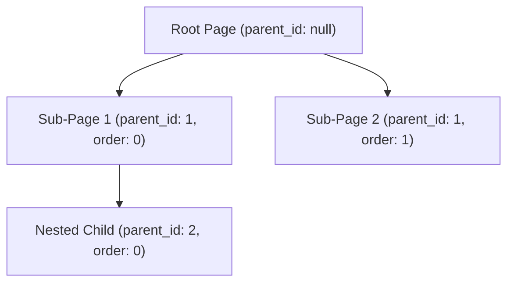
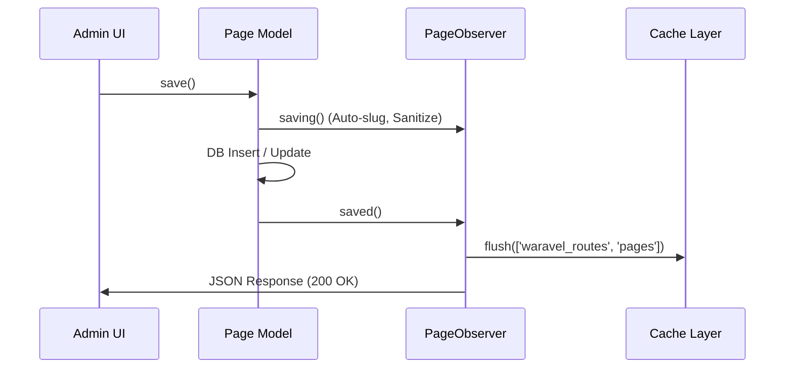

<div class="guide-banner guide-banner-dev"><span>⚙️</span> Developer Guide: Core Architecture</div>

# Page Management Architecture & Internals

The **Page Management** system in Waravel (`Sobberrc\Waravel\Models\Page`) powers dynamic content storage, hierarchical parent-child relationships, nested permalink routing, and zero-reload AJAX mutations.

---

## 🗄️ Database Schema (`pages` Table)

The `pages` table is designed for high-concurrency read operations, structured metadata storage, and nested tree structures:

| Column | Type | Constraints / Modifiers | Description |
| :--- | :--- | :--- | :--- |
| `id` | `unsignedBigInteger` | `primaryKey`, `autoIncrement` | Unique page record identifier. |
| `parent_id` | `unsignedBigInteger` | `nullable`, `index`, `foreignKey(pages.id)->nullOnDelete()` | References parent page ID for hierarchical tree nesting. |
| `order_column` | `integer` | `default(0)`, `index` | Integer sequence for custom manual drag-and-drop or hierarchical ordering. |
| `title` | `string(255)` | `not null` | The page title / headline. |
| `slug` | `string(255)` | `not null`, `index` | URL-safe permalink slug. Guaranteed unique across the same nesting level. |
| `content` | `longText` | `nullable` | Raw HTML, markdown, or JSON serialized builder blocks. |
| `template` | `string(100)` | `default('default-template')` | The Blade template view name resolved from active theme directory. |
| `status` | `enum` | `'published', 'draft', 'archived'` | Lifecycle publication state. |
| `visibility` | `enum` | `'public', 'password', 'private'` | Access control level. Password-protected pages require session auth. |
| `password` | `string(255)` | `nullable` | Hashed password if `visibility = 'password'`. |
| `author_id` | `unsignedBigInteger` | `index`, `foreignKey(users.id)` | User ID of the content creator. |
| `featured_image_id`| `unsignedBigInteger` | `nullable`, `foreignKey(media.id)` | Foreign key referencing the primary hero/thumbnail in `media` table. |
| `seo_title` | `string(255)` | `nullable` | Custom `<title>` tag for search engine crawlers. |
| `seo_description` | `text` | `nullable` | Custom `<meta name="description">` snippet. |
| `seo_schema` | `json` | `nullable` | Structured JSON-LD payload (e.g. `WebSite`, `Article`, `Organization`). |
| `redirect_url` | `string(255)` | `nullable` | Destination URL if forwarding traffic. |
| `redirect_type` | `smallInteger` | `nullable` | HTTP redirect status code (e.g. `301` Permanent, `302` Temporary). |
| `deleted_at` | `timestamp` | `nullable`, `index` | Soft delete timestamp for trash bin management. |
| `created_at` / `updated_at` | `timestamp` | `nullable` | Standard Eloquent timestamps. |

---

## 🌳 Hierarchical Tree Architecture

Waravel supports unlimited parent-child nesting without recursive query explosion.



### Model Relationships
The `Page` model implements self-referencing Eloquent relationships:

```php
namespace Sobberrc\Waravel\Models;

use Illuminate\Database\Eloquent\Model;
use Illuminate\Database\Eloquent\SoftDeletes;
use Illuminate\Database\Eloquent\Relations\BelongsTo;
use Illuminate\Database\Eloquent\Relations\HasMany;

class Page extends Model
{
    use SoftDeletes;

    protected $table = 'pages';

    protected $casts = [
        'seo_schema' => 'array',
        'order_column' => 'integer',
        'parent_id' => 'integer',
    ];

    /**
     * Parent page relationship.
     */
    public function parent(): BelongsTo
    {
        return $this->belongsTo(self::class, 'parent_id');
    }

    /**
     * Child pages ordered by sequence.
     */
    public function children(): HasMany
    {
        return $this->hasMany(self::class, 'parent_id')->orderBy('order_column', 'asc');
    }

    /**
     * Recursive child tree relationship for eager loading.
     */
    public function childrenRecursive(): HasMany
    {
        return $this->children()->with('childrenRecursive');
    }
}
```

### Tree Resolution Algorithm
When the user toggles **Hierarchical View** (`#toggle-hierarchy-btn`), the controller loads the complete tree using a single eager-loaded recursive query, flattening it in memory into a depth-annotated collection with visual indentation dashes (`—`):

```php
public function buildHierarchyTree($pages, $parentId = null, $depth = 0)
{
    $branch = collect();

    foreach ($pages->where('parent_id', $parentId)->sortBy('order_column') as $page) {
        $page->depth = $depth;
        $page->visual_prefix = str_repeat('— ', $depth);
        $branch->push($page);

        $children = $this->buildHierarchyTree($pages, $page->id, $depth + 1);
        $branch = $branch->merge($children);
    }

    return $branch;
}
```

---

## 🔍 Advanced Multi-Field Search Engine

The Page Index provides an advanced multi-field search engine supporting logical operators and matching modes:

```php
public function scopeAdvancedSearch($query, array $criteria)
{
    $operator = ($criteria['logical_operator'] ?? 'AND') === 'OR' ? 'orWhere' : 'where';
    $matchMode = $criteria['match_mode'] ?? 'broad';

    return $query->where(function ($subQuery) use ($criteria, $operator, $matchMode) {
        foreach ($criteria['fields'] as $field => $value) {
            if (empty($value)) continue;

            $searchTerm = $matchMode === 'exact' ? $value : "%{$value}%";
            $sqlOp = $matchMode === 'exact' ? '=' : 'LIKE';

            $subQuery->$operator($field, $sqlOp, $searchTerm);
        }
    });
}
```

---

## ⚡ Zero-Reload AJAX Mutation Endpoints

To maintain 60fps responsiveness in the admin interface, status and visibility toggles execute via lightweight JSON endpoints with optimistic UI updates:

### 1. Inline Status Update (`POST /admin/pages/update-status`)
```php
public function updateStatus(Request $request)
{
    $validated = $request->validate([
        'id' => 'required|exists:pages,id',
        'status' => 'required|in:published,draft,archived,trash',
    ]);

    $page = Page::withTrashed()->findOrFail($validated['id']);

    if ($validated['status'] === 'trash') {
        $page->delete(); // Triggers soft delete
        return response()->json(['success' => true, 'action' => 'trashed']);
    }

    if ($page->trashed()) {
        $page->restore();
    }

    $page->update(['status' => $validated['status']]);

    // Invalidate routing cache
    Cache::tags(['waravel_routes', 'pages'])->flush();

    return response()->json([
        'success' => true,
        'status' => $page->status,
        'badge_class' => $page->status === 'published' ? 'bg-emerald-500/20 text-emerald-400' : 'bg-amber-500/20 text-amber-400'
    ]);
}
```

### 2. Inline Visibility Update (`POST /admin/pages/update-visibility`)
```php
public function updateVisibility(Request $request)
{
    $validated = $request->validate([
        'id' => 'required|exists:pages,id',
        'visibility' => 'required|in:public,password,private',
        'password' => 'nullable|string|min:4',
    ]);

    $page = Page::findOrFail($validated['id']);
    $data = ['visibility' => $validated['visibility']];

    if ($validated['visibility'] === 'password' && !empty($validated['password'])) {
        $data['password'] = bcrypt($validated['password']);
    }

    $page->update($data);

    return response()->json(['success' => true, 'visibility' => $page->visibility]);
}
```

---

## 📡 Lifecycle Events & Observers

Waravel dispatches strict Eloquent events throughout the page lifecycle:



1. **`PageSaving` Observer:**
   * Validates and auto-generates slug from title if empty.
   * Ensures slug uniqueness: if `about` already exists, appends `-1`, `-2`.
   * Enforces root homepage slug lock (`home`).
2. **`PageSaved` Observer:**
   * Clears tag caches: `Cache::tags(['waravel_routes', 'pages'])->flush()`.
   * Regenerates dynamic XML sitemaps if auto-generation is enabled.
3. **`PageDeleting` / `PageRestored` Observers:**
   * Maintains parent-child references during soft delete.
   * Safely detaches child pages or cascades trash operations based on system settings.
