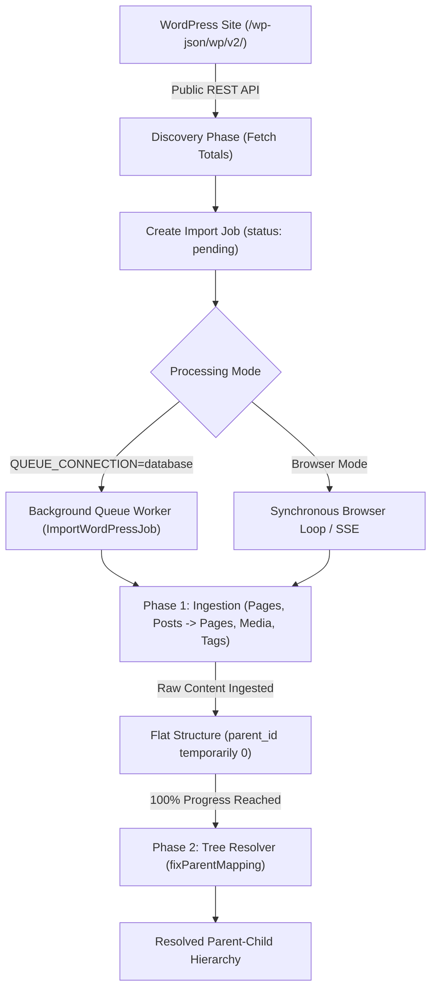

<div class="guide-banner guide-banner-dev"><span>🛠️</span> Developer Guide: Technical Reference</div>

# WordPressImporter: Technical & Architectural Reference

Technical reference for the **WordPressImporter** plugin: dual execution modes (Queue Workers vs. Browser Polling), REST API ingestion, state machine lifecycle, Server-Sent Events (SSE), and two-phase parent-child hierarchy resolution.

---

## Architecture Overview

The WordPress Importer interacts directly with the standard WordPress REST API (`/wp-json/wp/v2/`) to discover, ingest, and normalize remote content into native Waravel Eloquent models.



---

## 1. Discovery & Audit Phase

When the user triggers **Fetch Totals**, the `WordPressImporterService` makes non-blocking HTTP requests to the source endpoints:
* `/wp-json/wp/v2/pages?per_page=1` &rarr; Extracts `X-WP-Total` header for pages.
* `/wp-json/wp/v2/posts?per_page=1` &rarr; Extracts `X-WP-Total` header for blog articles.
* `/wp-json/wp/v2/tags?per_page=1` &rarr; Extracts `X-WP-Total` header for taxonomy tags.
* `/wp-json/wp/v2/media?per_page=1` &rarr; Extracts `X-WP-Total` header for media files.

The discovered totals are persisted in the `waravel_import_jobs` table to calculate progress percentages deterministically.

---

## 2. Dual Execution Engine: Queue vs. Browser Mode

The importer inspects the active Laravel queue configuration to determine execution strategy:

### A. Background Queue Processing (`QUEUE_CONNECTION=database`)
* Dispatches `ImportWordPressJob` to the Laravel database queue.
* Queue workers execute asynchronously in the background via PHP CLI or Supervisor.
* Server-Sent Events (SSE) or client polling at `/waravel/import/wordpress/progress/{id}` read current state without locking HTTP threads.
* Client disconnection does not interrupt the migration job.

### B. Browser-Driven Polling Fallback
* Used when `QUEUE_CONNECTION=sync` or on restricted hosting environments where background daemon workers are unavailable.
* Frontend maintains a persistent JavaScript worker loop making sequential POST requests:
  * Ingests chunks of 10–20 records per batch.
  * Responds with incremental progress telemetry.
  * Browser must remain open until state transitions to `completed`.

---

## 3. Two-Phase Ingestion & Hierarchy Resolution

Rebuilding nested parent-child trees across distributed REST APIs presents an ordering problem: child pages may be fetched before their parents are ingested.

Waravel solves this with an architectural **Two-Phase Resolver**:

### Phase 1: Ingestion (Flat Storage)
1. All pages and posts are ingested into the database with `parent_id` temporarily mapped to the designated container (`$parentContainerId` or `0`).
2. The original WordPress ID (`wp_id`) and remote parent ID (`wp_parent_id`) are indexed in the `wordpress_importer_slugs` mapping table:
   ```sql
   CREATE TABLE `wordpress_importer_slugs` (
       `id` BIGINT UNSIGNED AUTO_INCREMENT PRIMARY KEY,
       `job_id` BIGINT UNSIGNED,
       `wp_id` BIGINT UNSIGNED,
       `wp_parent_id` BIGINT UNSIGNED,
       `waravel_page_id` BIGINT UNSIGNED,
       `slug` VARCHAR(255),
       INDEX (`job_id`, `wp_id`)
   );
   ```

### Phase 2: Tree Resolution (`fixParentMapping`)
Once the primary ingestion reaches **100%**, the system executes the tree reconstruction algorithm:
```php
public function resolvePageHierarchy(int $jobId, int $containerId): void
{
    $slugMappings = DB::table('wordpress_importer_slugs')
        ->where('job_id', $jobId)
        ->where('wp_parent_id', '>', 0)
        ->get();

    foreach ($slugMappings as $mapping) {
        $parentRecord = DB::table('wordpress_importer_slugs')
            ->where('job_id', $jobId)
            ->where('wp_id', $mapping->wp_parent_id)
            ->first();

        if ($parentRecord) {
            Page::where('id', $mapping->waravel_page_id)->update([
                'parent_id' => $parentRecord->waravel_page_id
            ]);
        }
    }
}
```
This guarantees 100% accurate parent-child relations regardless of API pagination order.

---

## 4. Posts-to-Pages Normalization

Waravel does not restrict imported WordPress blog posts to a legacy blog feed. Instead, the transformation service normalizes posts into top-level business pages:
* `post_type: post` &rarr; Converted to `Page` model.
* Post categories and tags are mapped to Waravel `Tag` records.
* Embedded rich-text formatting and custom layout blocks are sanitized and ported to TinyMCE/Canvas-compatible markup.

---

## 5. Media Sideloading & Content URL Rewriting

### Inline Images vs. Full Media Library
* **Always Sideloaded:** All `` tags embedded in page/post bodies are detected via DOM parsing, downloaded locally into `/storage/app/public/media/`, and registered in the `Media` database table.
* **Full Media Sync (Optional):** When the Media checkbox is selected, the importer paginates through `/wp-json/wp/v2/media` to mirror unattached media assets.

### Internal Link Rewriter
When a `new_url` is provided, the post-processing service parses imported HTML content:
```php
$rewrittenContent = preg_replace(
    '#' . preg_quote($sourceWpUrl, '#') . '#i',
    $targetWaravelUrl,
    $rawHtml
);
```
Internal links pointing to migrated pages are updated to their new canonical slugs automatically.

---

## 6. SEO Metadata Hydration

The importer probes for active SEO plugins on the source site:
* **Yoast SEO:** Extracts `yoast_head_json.title`, `yoast_head_json.description`, and `yoast_head_json.schema`.
* **Rank Math:** Extracts `rank_math_title`, `rank_math_description`, and Open Graph tags.
* **WordPress Core Fallbacks:** Derives title and excerpt if dedicated SEO meta fields are missing.

Extracted metadata is normalized and inserted directly into Waravel's SEO columns (`meta_title`, `meta_description`, `seo_schema`).
