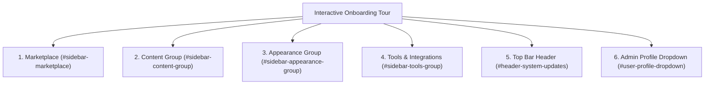

<div class="guide-banner guide-banner-user"><span>🗺️</span> User Guide: Administration Tour</div>

# Full Admin Dashboard & Features Walkthrough

Welcome to the **Waravel Admin Dashboard** (`/admin/dashboard` or `/waravel`). Designed specifically for speed, clarity, and ease of use, the administration panel brings together all your content, visual layouts, extensions, and system health metrics into a single unified workspace.

When you first log in, an interactive onboarding tour (`.driver-popover, .tour-modal`) greets you with a guided walkthrough of every major control section.

---

## 🧭 Interactive Tour & Navigation Structure



---

## 🛍️ Step 1: The Marketplace (`#sidebar-marketplace`)

The top link in the navigation menu opens the built-in application store:

* **Location:** `#sidebar-marketplace`, `a[href*='marketplace']`
* **Purpose:** Discover, download, and install official plugins, design themes, and creative asset bundles with 1-click simplicity.
* **Key Features:**
  * Real-time license entitlement verification via the green **Sync Live** indicator.
  * Category navigation across **Themes**, **Plugins**, and **Assets**.
  * Filter bar to search through **All**, **Featured**, **Popular**, and **New** additions.
  * 1-Click zero-code installation and live activation.
  * Multi-extension batch setup with the sliding **Bulk Actions Toolbar**.

---

## 📝 Step 2: The Content Section (`#sidebar-content-group`)

The **Content** group is where your day-to-day website data resides. It gives you complete control over your written copy, visual assets, and taxonomies:

* **Posts (`a[href*='posts']`):**
  * Manage timely blog articles, press releases, company news, and categorized editorial stories.
* **Pages (`a[href*='pages']`):**
  * The central index of all permanent business pages (Homepage, About Us, Services, Contact, Pricing).
  * Features the **Hierarchical Tree View** toggle (`#toggle-hierarchy-btn`) to display parent-child relationships with nested dashes (`—`), multi-field **Advanced Search**, inline AJAX status and visibility editors, and complete trash lifecycle management.
* **The Page Editor (`/waravel/pages/{id}/edit`):**
  * Switch effortlessly between the **Standard Editor** (rich text formatting, H1–H6 semantic headings, media library integration) and the dark-mode **Code Tab** for custom HTML/CSS embed blocks.
  * Manage parent page assignments, featured hero images, and full **SEO Meta Settings** (title, description, and JSON-LD structured schemas).
* **Media Vault (`a[href*='media']`):**
  * High-speed visual asset library at `/waravel/media`.
  * Batch upload up to 5 files simultaneously (JPG, PNG, WebP, GIF, SVG) with live progress tracking.
  * 8-attribute advanced search, sliding inspector drawer (`#imageDetailsPanel`), 1-click clipboard URL copying (`#copyUrlBtn`), and sequential gallery steppers (`#prevImageBtn` / `#nextImageBtn`).
* **Tags (`a[href*='tags']`):**
  * Create, edit, and organize taxonomy keywords across all posts and pages with real-time content counters.

---

## 🎨 Step 3: The Appearance Section (`#sidebar-appearance-group`)

The **Appearance** group gives you complete creative control over your website's visual brand identity and layout structures:

* **Themes (`a[href*='themes']`):**
  * Browse installed designs, preview demo layouts, and activate starter or custom commercial themes.
* **Theme Customizer (`a[href*='customize']`):**
  * Real-time visual customizer for brand logos (with custom dimension controls), primary and secondary brand colors, typography pairings, and dark/light skin modes.
* **Navigation Menus (`a[href*='menus']`):**
  * Build and reorder multi-level header menus, footer links, and mobile slide-out navigation trees with drag-and-drop ease.
* **Layout Studio (`a[href*='layout']`):**
  * Orchestrate structural site regions: customize global header layouts, sticky navigation bars, sidebar widths, and multi-column footers.
* **Widget Editor (`a[href*='widgets']`):**
  * Drag and drop dynamic modular blocks (hero callouts, newsletter capture, recent post sliders, and customer reviews) into designated theme widget zones.
* **Visual Builder (`a[href*='builder']`):**
  * Launch the Waravel Drag & Drop Page Builder for visual block-by-block layout composition.

---

## 🔧 Step 4: Tools & Third-Party Integrations (`#sidebar-tools-group`)

The **Tools** section provides technical utilities to configure active plugins and securely connect external cloud services:

* **Plugins Overview (`a[href*='plugins']`):**
  * Configure settings for installed extensions, including the **WordPress Importer**, **Mail Tester**, **Media Optimizer**, **Page Cleaner**, and **Redirect Manager**.
* **Third-Party Integrations:**
  * Securely connect external APIs, analytics tracking tags, email marketing service providers (Mailgun, SendGrid, Postmark), payment gateways, and cloud storage disks (Amazon S3, Cloudflare R2).

---

## 🚀 Step 5: System Updates in the Top Bar (`#header-system-updates`)

Up in the top navigation header bar, the **System Updates** tab keeps your software running smoothly:

* **One-Click Delivery:** Update core framework infrastructure, themes, and plugins with a single click.
* **Auto-Pilot Background Updates:** Toggle automated hourly checks to apply security patches silently without downtime.
* **Pre-Flight Health Diagnostics:** Cryptographic SHA-256 validation and automated PHP `zip` extension verification.

---

## 🛠️ Step 6: The Maintenance Center (`#header-maintenance`)

Positioned next to updates in the top header, the **Maintenance Center** gives you instant access to low-level health tools:

* **Cache Manager:** 1-Click flushing for compiled Blade views, application cache, configuration cache, and route tables.
* **System Logs & Diagnostics:** Review real-time application error logs, database query slow-logs, and server resource usage.
* **Scheduler Diagnostics:** Monitor background cron jobs, database queue runners, and automated backup schedules.

---

## ⚙️ Step 7: Global Platform Settings (`#header-settings`)

The **Global Settings** tab allows you to configure platform-wide preferences:

* **General Information:** Site title, tagline, admin email, default timezone, and localized date formats.
* **Rendering Modes:** Choose between ultra-fast Server-Side Rendering (SSR) or reactive Single-Page Application (SPA) modes.
* **Business Details:** Company address, phone numbers, social media links, and tax/VAT registration identifiers.
* **Media Rules:** Configure maximum upload thresholds (up to 100MB) and automated WebP compression rules (15MB threshold).

---

## 👤 Step 8: Admin Profile Dropdown (`#user-profile-dropdown`)

Located at the far right of the top header bar:

* Click your administrator avatar or name to reveal the profile options menu.
* **Account Details:** Update your administrator name, contact email, and avatar photo.
* **Security & Passwords:** Change your password and configure Two-Factor Authentication (2FA) for bulletproof login security.
* **Notification Preferences:** Customize which system alerts and security notices are delivered to your inbox.

---

## 🏁 Step 9: Completing the Tour & Toast Notification

When you reach the final step of the onboarding tour:

1. Click the amber **Finish** button (`button:has-text('Finish')`, `.driver-close-btn`).
2. The tour modal and dimmed backdrop smoothly fade away, leaving your full dashboard ready for work.
3. A friendly, non-intrusive toast notification appears in the lower-right corner:
   ```text
   Tour completed! Click here anytime to reopen.
   ```
4. If you ever need to revisit the interactive tour, simply click the notification pill to restart it from step one at any time.
