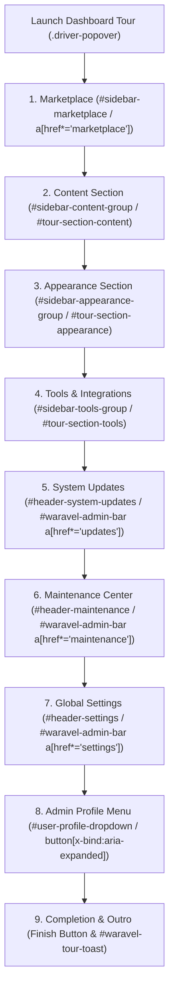

<div class="guide-banner guide-banner-user"><span>🗺️</span> User Guide: Administration Tour</div>

# Full Admin Dashboard & Features Walkthrough

Welcome to the **Waravel Admin Dashboard** (`/admin/dashboard` or `/waravel`). Designed specifically for speed, clarity, and ease of use, the administration panel brings together all your content, visual layouts, extensions, and system health metrics into a single unified workspace.

When you first log in, an interactive onboarding tour (`.driver-popover, .tour-modal`) greets you with a guided walkthrough of every major control section across the sidebar and header.

---

## 🧭 Interactive Tour & Navigation Structure

The built-in onboarding tour guides new administrators step-by-step through nine foundational landmarks:



---

## 🛍️ Step 1: The Marketplace (`#sidebar-marketplace`)

The top section in the navigation menu opens the built-in application marketplace:

* **Location:** `#sidebar-marketplace`, `a[href*='marketplace']`
* **Tour Tooltip:** *"Discover & Install official plugins and themes"*
* **Purpose:** Discover, download, and install official plugins, design themes, and creative asset bundles with 1-click simplicity.
* **Key Features:**
  * **Themes (`a[href*='themes']`):** One-click layout skins and storefront designs.
  * **Plugins (`a[href*='plugins']`):** Feature extensions such as Mail Tester, WP Importer, and Media Optimizer.
  * **Assets (`a[href*='assets']`):** Visual assets, iconography packs, and downloadable bundles.
  * **Real-time Synchronization:** License entitlement verification via the green **Sync Live** indicator.
  * **Category Navigation:** Switch between **All**, **Featured**, **Popular**, and **New** additions.
  * **Zero-Code Setup:** 1-Click installation with live activation and the sliding **Bulk Actions Toolbar**.

---

## 📝 Step 2: The Content Section (`#sidebar-content-group`)

The **Content** group (`#sidebar-content-group` or `#tour-section-content`) is where your day-to-day website data resides. It gives you complete control over your written copy, visual media, and taxonomies:

* **Posts (`a[href*='posts']`):**
  * Manage timely blog articles, press releases, company news, and categorized editorial stories.
* **Pages (`a[href*='pages']`):**
  * The central index of all permanent business pages (Homepage, About Us, Services, Contact, Pricing).
  * Features the **Hierarchical Tree View** toggle (`#toggle-hierarchy-btn`) to display parent-child relationships with nested dashes (`—`), multi-field **Advanced Search**, inline AJAX status and visibility editors, and complete trash lifecycle management.
* **The Page Editor (`/waravel/pages/{id}/edit`):**
  * Switch effortlessly between the **Standard Editor** (rich text formatting, H1–H6 semantic headings, media library integration) and the dark-mode **Code Tab** for custom HTML/CSS embed blocks.
  * Manage parent page assignments, featured hero images, and full **SEO Meta Settings** (title, description, and JSON-LD structured schemas).
* **Media Vault (`a[href*='media']`):**
  * High-speed visual asset library at `/waravel/media`.
  * Batch upload up to 5 files simultaneously (JPG, PNG, WebP, GIF, SVG) with live progress tracking.
  * 8-attribute advanced search, sliding inspector drawer (`#imageDetailsPanel`), 1-click clipboard URL copying (`#copyUrlBtn`), and sequential gallery steppers (`#prevImageBtn` / `#nextImageBtn`).
* **Tags (`a[href*='tags']`):**
  * Create, edit, and organize taxonomy keywords across all posts and pages with real-time content counters.

---

## 🎨 Step 3: The Appearance Section (`#sidebar-appearance-group`)

The **Appearance** group (`#sidebar-appearance-group` or `#tour-section-appearance`) gives you complete creative control over your website's visual brand identity and layout structures:

* **Themes (`a[href*='themes']`):**
  * Browse installed designs, preview demo layouts, and activate starter or custom commercial themes.
* **Navigation Menus (`a[href*='menus']`):**
  * Build and reorder multi-level header menus, footer links, and mobile slide-out navigation trees with drag-and-drop ease.
* **Theme Customizer (`a[href*='customize']`):**
  * Real-time visual customizer for brand logos (with custom dimension controls), primary and secondary brand colors, typography pairings, and dark/light skin modes.
* **Layout Studio (`a[href*='layout']`):**
  * Orchestrate structural site regions: customize global header layouts, sticky navigation bars, sidebar widths, and multi-column footers.
* **Widget Editor (`a[href*='widgets']`):**
  * Drag and drop dynamic modular blocks (hero callouts, newsletter capture, recent post sliders, and customer reviews) into designated theme widget zones.
* **Visual Builder (`a[href*='builder']`):**
  * Launch the Waravel Drag & Drop Page Builder for visual block-by-block layout composition.

---

## 🔧 Step 4: Tools & Third-Party Integrations (`#sidebar-tools-group`)

The **Tools** section (`#sidebar-tools-group` or `#tour-section-tools`) provides technical utilities to configure active plugins and securely connect external cloud services:

* **Plugins Overview (`a[href*='plugins']`):**
  * Configure settings for installed extensions, including the **WordPress Importer**, **Mail Tester**, **Media Optimizer**, **Page Cleaner**, and **Redirect Manager**.
* **Integrations (`a[href*='integrations']`):**
  * Centrally manage AI providers and external platform integrations (OpenAI, Anthropic, Gemini, Mistral, Groq, Ollama).
  * Connect external APIs, analytics tracking tags, email marketing service providers (Mailgun, SendGrid, Postmark), payment gateways, and cloud storage disks (Amazon S3, Cloudflare R2).

---

## 🚀 Step 5: System Updates in the Top Bar (`#header-system-updates`)

Up in the top navigation header bar (`#waravel-admin-bar a[href*='updates']`):

* **One-Click Delivery:** Update core framework infrastructure, themes, and plugins with a single click.
* **Dropdown Preview & Status Badges:** Hovering over the update badge reveals available updates. A pulsing red pill badge highlights the total number of updates awaiting review.
* **Auto-Pilot Background Updates:** Toggle automated hourly checks to apply verified patches silently without taking your website offline.
* **Pre-Flight Health Diagnostics:** Automated cryptographic SHA-256 validation and PHP `zip` extension verification before any archive is unpacked.

---

## 🛠️ Step 6: The Maintenance Center (`#header-maintenance`)

Positioned next to updates in the top header (`#waravel-admin-bar a[href*='maintenance']`):

* **Cache Manager:** 1-Click flushing for compiled Blade views (`view:clear`), application cache (`cache:clear`), configuration cache (`config:clear`), and route tables (`route:clear`).
* **Optimize Clear:** Run a safe, all-in-one purge of all cached layers simultaneously via the amber **Optimize Clear** button.
* **Real-Time Log Streaming:** Review live tails of `laravel.log` directly in browser without SSH or FTP.
* **Scheduler Heartbeat Diagnostics:** Monitor background cron jobs, database queue runners, and automated backup schedules. If cron stops pulsing, an amber warning icon (**⚠️**) illuminates immediately.

---

## ⚙️ Step 7: Global Platform Settings (`#header-settings`)

The **Global Settings** tab in the top header (`#waravel-admin-bar a[href*='settings']`):

* **Rendering Modes:** Choose between **Blank Canvas** (zero-dependency fallback), **Laravel Layout** (standard Blade templates), or **Waravel Theme Layout** (widget-aware rendering).
* **Business Details:** Company name, physical business address, privacy policy URL, and terms of service links (essential for advertising and compliance audits).
* **Media Rules:** Configure maximum upload thresholds (up to 100MB), responsive sub-size generation (Thumbnail 150x150, Medium 300x300, Large 1024x1024), maximum dimension caps (e.g. 2560px), and automated WebP compression quality.

---

## 👤 Step 8: Admin Profile Dropdown (`#user-profile-dropdown`)

Located at the far right of the top header bar (`#waravel-admin-bar button[x-bind:aria-expanded]` or Alpine container `div[x-data*="userMenuOpen"]`):

* Click your administrator avatar or name pill to expand the profile options menu:
* **👤 My Profile (`/waravel/profile`):** Update administrator display name, contact email address, and avatar photo.
* **🔑 Security & Passwords:** Change your password and configure Two-Factor Authentication (2FA) for login security.
* **🔔 Notification Preferences:** Configure system alerts, lead delivery, and security update advisories.
* **🚪 Logout:** Securely terminate your administrative session via POST to `route('waravel-logout')`.

---

## 🏁 Step 9: Completing the Tour & Toast Notification

When you reach the final step of the interactive onboarding tour:

1. Click the amber **Finish** button (`button:has-text('Finish')`, `.driver-close-btn`).
2. The tour modal and dark slate backdrop (`#driver-page-overlay`) smoothly fade away, leaving your full dashboard ready for work.
3. A friendly, non-intrusive floating toast notification appears at the bottom center (`#waravel-tour-toast`):
   ```text
   🗺️ Tour closed. You can reopen it anytime.   [ Reopen ]   ✕
   ```
4. If you ever need to revisit the interactive tour, simply click **Reopen** to restart the tour from step one at any time. If dismissed permanently using the footer checkbox ("*Don't show again*"), the setting is stored in local storage (`waravel_dashboard_tour_dismissed`).
