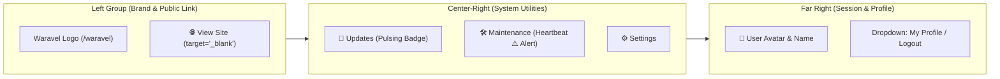

<div class="guide-banner guide-banner-user"><span>🧭</span> User Guide: Global Navigation</div>

# The Top Bar

The **Top Bar** (`#waravel-admin-bar`) is your persistent command center, anchored securely at the top of your Waravel administration interface. Engineered for seamless multi-tasking, it ensures that whether you are drafting a post, reviewing media assets, or adjusting layout blocks, instant access to system diagnostics, update alerts, and platform settings is only a single click away.

---

## 🧭 Navigation Landmark Overview



---

## 🏛️ Left Side: Primary Landmarks

* **Waravel Brand & Dashboard Home:**
  * Located at the upper left of the sidebar and top bar seam.
  * Clicking the brand logo or title immediately returns you to the main dashboard summary (`/waravel` or `/admin/dashboard`).
* **View Site (`🌐`):**
  * Target link: `<a href="/" target="_blank" class="admin-bar-item">`
  * Opens your live public frontend in a separate browser tab.
  * Allows you to instantly preview newly published pages, theme switches, or brand color adjustments from your visitors' perspective without losing your active place in the admin dashboard.

---

## 🛠️ Center-Right: System Utilities & Status Indicators

The middle and right sections of `#waravel-admin-bar` provide real-time status indicators and one-click access to core operational areas:

### 1. [Updates](topbar-updates.md) (`🔄`)
* **Route:** `/waravel/updates` (`route('waravel.updates.index')`)
* **Status Badges:**
  * When updates are available, a vibrant red badge displays the pending count:
    ```html
    <span style="background: #ef4444; color: #fff; font-size: 10px; font-weight: 700; padding: 1px 6px; border-radius: 10px;">{{ $updateCount }}</span>
    ```
  * Accounts for Core infrastructure releases, active theme revisions, and installed plugin updates.
* **Hover Interaction:** Hovering over the update badge reveals available updates. Clicking navigates directly to the unified **Update Centre**.

### 2. [Maintenance](topbar-maintenance.md) (`🛠️`)
* **Route:** `/waravel/maintenance` (`route('waravel.maintenance.index')`)
* **Health Beacon & Heartbeat Warning Alert (`⚠️`):**
  * The background scheduler Heartbeat checks whether the server cron job is actively pulsing every minute.
  * If the cron scheduler ceases pulsing for more than 5 minutes, an amber warning icon (**⚠️**) illuminates immediately beside the Maintenance link in the header:
    ```html
    <span title="Heartbeat Missing" style="cursor: help; margin-left: 6px; font-size: 14px;">⚠️</span>
    ```
* **One-Click Diagnostic Utilities:** Instant access to 1-click cache purges (`optimize:clear`), real-time browser log tail streaming, and developer override publishing.

### 3. [Settings](topbar-settings.md) (`⚙️`)
* **Route:** `/waravel/settings` (`route('waravel.settings.index')`)
* **Global Platform Controls:** Manage layout architectures (Blank Canvas vs. Laravel Layout vs. Theme Layout), business metadata for ad audits, and media auto-optimization thresholds.

---

## 👤 Far Right: Account & Session Management

Located at the far right of `#waravel-admin-bar`:

* **User Avatar & Profile Pill:**
  * Interactive Alpine.js component (`div x-data="{ userMenuOpen: false }"`).
  * Displays a stylized round avatar badge with the administrator's initial alongside their display name:
    ```html
    <div class="w-7 h-7 rounded-full bg-white/20 flex items-center justify-center font-bold text-xs text-white">
        {{ strtoupper(substr(Auth::guard('waravel')->user()->name, 0, 1)) }}
    </div>
    <span class="ml-3 font-medium text-sm">{{ Auth::guard('waravel')->user()->name }}</span>
    ```
* **Profile Dropdown Menu:**
  * Clicking the avatar opens a sleek dark menu (`x-show="userMenuOpen"`):
    * **👤 My Profile:** Navigates to `/waravel/profile` to update your display name, contact email, and security password.
    * **🚪 Logout:** Sends a secure POST request to `route('waravel-logout')` to immediately destroy the administrative session and return you to the login screen.

---

## 📱 Mobile Responsive Header Navigation

On mobile screens and narrow viewports:
* The desktop top bar items collapse into a high-visibility mobile toggle button:
  `<button @click="mobileMenuOpen = !mobileMenuOpen">`
* Tapping the hamburger icon expands a full-width sliding mobile navigation tray featuring enlarged touch targets for **Updates** (with red counter badge), **Settings**, **Maintenance** (with Heartbeat warning alert), **My Profile**, and **Logout**.
