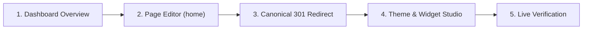

<div class="guide-banner guide-banner-user"><span>🏠</span> User Guide: Site Architecture</div>

# Setting Up Your Homepage & Canonical SEO Routing

Your homepage is your website’s digital front door—the very first impression potential clients, search engine crawlers, and visitors experience. In Waravel, setting up and customizing your homepage is intuitive, modular, and built on high-performance routing that preserves every ounce of your domain's search engine equity.

This guide walks through the exact 5-step workflow demonstrated in the official Waravel Video Walkthrough:



---

## 🏛️ Scene 1: Homepage Architecture & Navigation

To begin setting up your front page:
1. Log into your Waravel Administration Panel (`/admin/dashboard` or `/waravel`).
2. From the main overview screen, locate the left sidebar navigation.
3. Hover over the **Content** group and click on **Pages** (`a[href*="/waravel/pages"]`).
4. This takes you into the central Page Index where all website content resides.

---

## ✍️ Scene 2: Configuring the Home Page in Waravel

In Waravel, the homepage is managed through the central content engine with full access to rich text formatting, page templates, and search engine optimization schemas:

```
Pages Index → Locate row with slug "home" → Click "Edit"
```

1. **Locate the Home Page:**
   * In the pages table, locate the row labeled **Home** with the unique permalink slug: `home`.
   * Hover over the row and click the amber **Edit** link to enter the Page Creation Studio (`/waravel/pages/{id}/edit`).
2. **Refine Headlines & Body Content:**
   * **Page Title (`#title`):** Type your primary brand headline (e.g. *"Empowering Modern Business with High-Speed Laravel Architecture"*). Smart auto-capitalization assists with professional headline formatting.
   * **Permalink Slug (`#slug`):** Notice the slug field displays `home`. This is protected by default to ensure core routing stability.
   * **Editor Mode:** Use the rich-text **Standard Editor** for formatting headings (H1–H6), paragraphs, and bullet points. You can also click the amber **Add Media** button (`#openModalForContent`) to insert high-resolution hero graphics directly from your Media Vault.
   * **Raw Code Mode (`#btn-open-code`):** For advanced custom CSS or JavaScript animations, click the dark-mode Code tab to edit raw HTML directly.
3. **Template & Attributes Card:**
   * On the right-side control column, confirm the **Template** dropdown is set to `default-template` (or select a specialized landing page template such as `blank-canvas` or `full-width`).
4. **Search Engine Optimization (SEO) Meta Panel:**
   * Scroll down the page editor to the dedicated **SEO Meta Settings** section:
     * **SEO Title:** Craft a descriptive title under 60 characters that displays in browser tabs and Google search snippets.
     * **Meta Description:** Write an engaging, 150–160 character summary describing your business core value proposition.
     * **JSON-LD Schema Markup:** Paste valid JSON-LD structured data (such as `WebSite` or `Organization` schemas) to unlock rich Google search features, star ratings, or business contact cards.
5. **Publish Your Changes:**
   * Click the prominent amber **Update Page** button (`#savePageBtn`).
   * A crisp green in-DOM notification confirms: *"Page updated successfully."*

---

## 🔀 Scene 3: Canonical SEO Routing (`/home` → `/`)

When moving websites from legacy platforms or older WordPress installations, older backlinks, marketing campaigns, or visitor bookmarks may request `https://yourdomain.com/home` instead of your clean root URL (`https://yourdomain.com/`).

If both URLs load identical content without a proper redirect, search engines divide your link equity between two separate addresses and may flag duplicate content. Waravel resolves this with a permanent **HTTP 301 Canonical Redirect**.

### Method A: Clean Laravel Route Definition (`routes/web.php`)
Open your application's route file at `main_core/routes/web.php` in your code editor and declare a clean 301 permanent redirect:

```php
<?php

use Illuminate\Support\Facades\Route;

// Redirect legacy /home requests cleanly to root with HTTP 301
Route::redirect('/home', '/', 301);

// Serve the canonical homepage at root
Route::get('/', [App\Http\Controllers\PageController::class, 'home'])->name('home');
```

> [!TIP] Clearing Route Caches
> Whenever you modify route files on a production server, refresh Laravel's routing table by running:
> ```bash
> php artisan route:clear
> ```

### Method B: In-DOM Page Redirect Card (Zero Code)
If you prefer not to touch server code files, you can use Waravel's built-in **Page Redirect Manager**:
1. In the Page Editor for the `home` page, scroll to the bottom **Page Redirect** card.
2. Enter the **Destination URL**: `/`.
3. Set the **Redirect Type** dropdown to: `301 (Permanent Redirect)`.
4. Click **Save Redirect**. Waravel handles the HTTP redirection headers automatically.

---

## 🎨 Scene 4: Theme Customization & The Widget Studio

With your content written and canonical routing secured, tailor the visual styling and modular callouts on your front page:

1. **Theme Customizer:**
   * In the sidebar, navigate to **Appearance → Themes** (`/waravel/themes`).
   * Locate your active starter theme and click the **Customize** button.
   * Adjust your **Brand Logo** (upload SVG/PNG and configure exact display dimensions), set primary and secondary brand accent colors, and assign your primary navigation menu.
2. **The Widget Studio:**
   * Open the **Widget Editor** (or Layout Studio).
   * Drag and drop dynamic modular blocks into your theme’s designated homepage widget zones:
     * **Hero Banner Zone:** Add bold call-to-action buttons, lead generation badges, or video backgrounds.
     * **Featured Services Grid:** Configure a 3-column service showcase with icons and links.
     * **Testimonials Carousel:** Display customer reviews with verified star ratings.
     * **Lead Capture Card:** Connect a Waravel contact form or newsletter signup.
   * Click **Save Layout** to apply your changes instantly with zero page reloads.

---

## 🚀 Scene 5: Live Verification & Testing

Verify that your new homepage is performing flawlessly across all devices and search engine crawlers:

1. **Test Canonical 301 Redirection:**
   * Open a new browser window or private browsing tab.
   * In the address bar, type:
     ```text
     https://yourdomain.com/home
     ```
   * Press **Enter**.
   * Notice that the browser address bar instantaneously transforms to:
     ```text
     https://yourdomain.com/
     ```
   * The HTTP 301 redirect resolves in under 50 milliseconds, ensuring search engines pass 100% of backlink authority directly to your root domain.
2. **Review Visual Hierarchy:**
   * Confirm the hero headline, call-to-action buttons, responsive service cards, and footer navigation render cleanly on desktop, tablet, and mobile screen sizes.
3. **Inspect Search Engine Schemas:**
   * Right-click the page and select **View Page Source** (or run Google's Rich Results Test tool) to verify that your `<title>`, `<meta name="description">`, and JSON-LD structured data scripts are active and properly formatted.
