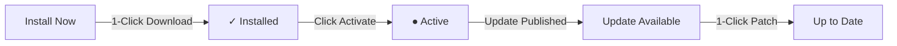

<div class="guide-banner guide-banner-user"><span>🛍️</span> User Guide: Extensions & Ecosystem</div>

# The Waravel Marketplace: Built-in App Store Walkthrough

Think of the **Waravel Marketplace** as the built-in app store for your website. Located directly under **Marketplace** on the main sidebar, it is the central command center where you can discover, add, and manage new tools, designs, and digital assets with a single click—without touching a single line of code, copying files, or configuring FTP credentials.

---

## 🟢 Real-Time License Connection: "Sync Live" Badge

At the very top-right corner of the Marketplace interface, you will immediately notice a high-contrast badge marked **Sync Live** alongside a pulsating green indicator dot (`#10b981`):

* **Active License Verification:** This badge confirms that your self-hosted website is securely paired with your [portal.waravel.com](https://portal.waravel.com) account.
* **Automatic Entitlement Polling:** It continuously verifies your license tier (Free, Starter, Pro, or The Suite), guaranteeing you receive instant update notifications the moment new security patches or major feature releases become available.
* **Zero Interruption:** Background sync runs silently without slowing down your admin dashboard or affecting front-end visitors.

---

## 📂 Primary Category Navigation

Directly beneath the header title, three distinct category pill tabs organize the entire ecosystem catalog:

```
[ 🎨 Themes ]    [ ⚡ Plugins ]    [ 📦 Assets ]
```

### 1. Themes (Design Identity)
The **Themes** tab (loaded by default at `/waravel/marketplace/themes`) houses complete visual skins for your website. 
* Clicking any theme applies a fresh, professionally crafted layout in seconds.
* Themes provide tailored color palettes, typography pairings, header structures, and responsive layouts for business sites, blogs, portfolios, and eCommerce stores.

### 2. Plugins (Functional Powers)
The **Plugins** tab equips your website with modular functional capabilities. Without writing PHP or configuring database tables, you can install:
* **Contact Forms:** Fast, accessible lead-capture forms with email notifications.
* **Page Content Generators:** Structured layout generators and automated drafting tools.
* **SEO Tools:** Comprehensive meta tag management, XML sitemaps, and social share previews to help you rank higher on search engines.
* **Security & Utilities:** Powerful utilities such as **File Guard**, **Redirect Manager**, **Mail Tester**, and the **WordPress Importer**.

### 3. Assets (Digital Resources)
The **Assets** tab offers curated design extras to enhance your pages:
* **Icon Collections:** Crisp SVG icon libraries (FontAwesome, Heroicons, Lucide).
* **Pre-made UI Blocks:** Hero sections, pricing tables, and testimonial grids ready to import into your visual builder.
* **Media Bundles:** High-resolution starter media packs.

---

## 🔍 Sub-Filter Navigation Bar

Directly below the primary category pills sits a streamlined sub-filter navigation bar to help you pinpoint extensions quickly:

* **All Items:** Browse the comprehensive catalog of all available tools and themes.
* **Featured:** Curated, high-impact picks hand-selected and recommended by the Waravel engineering team.
* **Popular:** Community favorites ranked by active installations and user satisfaction across the global Waravel network.
* **New:** The latest additions, recent releases, and major version upgrades.

---

## ⚡ Card Anatomy & 1-Click Installation Workflow

Every item in the Marketplace is presented as an interactive visual card designed for effortless management. Here is the step-by-step lifecycle:



### Visual Walkthrough: Installing & Activating Row 1 Extensions

1. **Card Header & Identification:**
   * Each card features an official brand icon, extension title (e.g. *Contact Form*, *File Guard*), verified author badge, brief description, and current semantic version.
2. **Step 1: Install Now:**
   * Hover over the amber **Install Now** button on your chosen card (such as *Contact Form*).
   * Click **Install Now**. Waravel securely fetches the cryptographically signed package from the portal distribution server and verifies its integrity.
   * Within 2 to 3 seconds, the button smoothly transforms into a vibrant green badge: **✓ Installed**.
3. **Step 2: Activate Now:**
   * With the package safely stored on your server, click the adjacent **Activate Now** button.
   * Waravel registers the extension’s service providers, routes, and database tables in real time.
   * The button transitions into a permanent green pill with a pulsating emerald indicator: **● Active**. Your new feature is instantly live and ready for use.
4. **Step 3: 1-Click Updates:**
   * When a developer publishes an update (as shown on the *File Guard* card), an amber **Update** button appears automatically.
   * Click **Update**. The latest release is downloaded, verified, and extracted in place.
   * The button smoothly transitions to **Up to date** with zero downtime or server restarts.

---

## 📦 Multi-Extension Batch Setup: The Bulk Actions Toolbar

When setting up a brand-new website or applying system-wide maintenance, installing extensions one-by-one is tedious. Waravel provides an automated batch setup experience:

```
┌────────────────────────────────────────────────────────────────────────┐
│ [✓] 2 selected    [ Bulk Actions ▼ ]    [ Apply ]                      │
└────────────────────────────────────────────────────────────────────────┘
```

1. **Select Multiple Items:**
   * Click the individual checkboxes located in the upper-left corner of any card (e.g. checking both *Contact Form* and *File Guard*).
   * Or click the master **Select All** checkbox to select every visible item on the screen.
2. **The Floating Bulk Toolbar (`#bulkActionsHeader`):**
   * The moment you check two or more items, the glassmorphic **Bulk Actions Toolbar** smoothly slides into view at the top of the grid, indicating the exact count: `"2 selected"`.
3. **Choose Batch Operation:**
   * Open the **Bulk Actions** dropdown menu to select your desired operation:
     * **Install:** Download and stage all selected extensions simultaneously.
     * **Install & Activate:** Perform both installation and live activation in one seamless sequential sequence.
     * **Activate:** Turn on multiple previously installed extensions.
     * **Update:** Batch-update all outdated plugins and themes to their latest stable releases.
4. **Execute & Dismiss:**
   * Click the amber **Apply** button. A clean progress indicator reports status as each item completes.
   * Once finished, uncheck the master checkbox or click **Deselect All** to dismiss the bulk toolbar cleanly.

---

## 👑 License Tier Entitlements

The Marketplace automatically adapts to the active license linked to your website:

| Tier Badge | Access Level | Included Items |
| :--- | :--- | :--- |
| **Free / Starter** | Standard Core Access | Essential community themes, standard plugins (Contact Form, WordPress Importer, Mail Tester). |
| <span class="badge badge-purple">PREMIUM</span> **Pro** | Advanced Commercial | Pro-edition plugins (Media Optimizer Pro, Page Cleaner Pro, Page Promoter Pro, Redirect Manager Pro), premium themes, and priority updates. |
| <span class="badge badge-amber">THE SUITE</span> | Full Enterprise Suite | Every current and future plugin, white-label options, automated multi-site orchestration, and direct engineer support. |

> [!TIP] Instant In-Place Upgrades
> If an extension requires a higher tier, the card displays an attractive purple **PREMIUM** pill. Clicking the card provides a 1-click link to [portal.waravel.com/plans-pricing](https://portal.waravel.com/plans-pricing). As soon as your license upgrades in the portal, return to your dashboard—the green **Sync Live** indicator detects the new entitlement immediately, allowing you to install without reinstalling or moving files!
