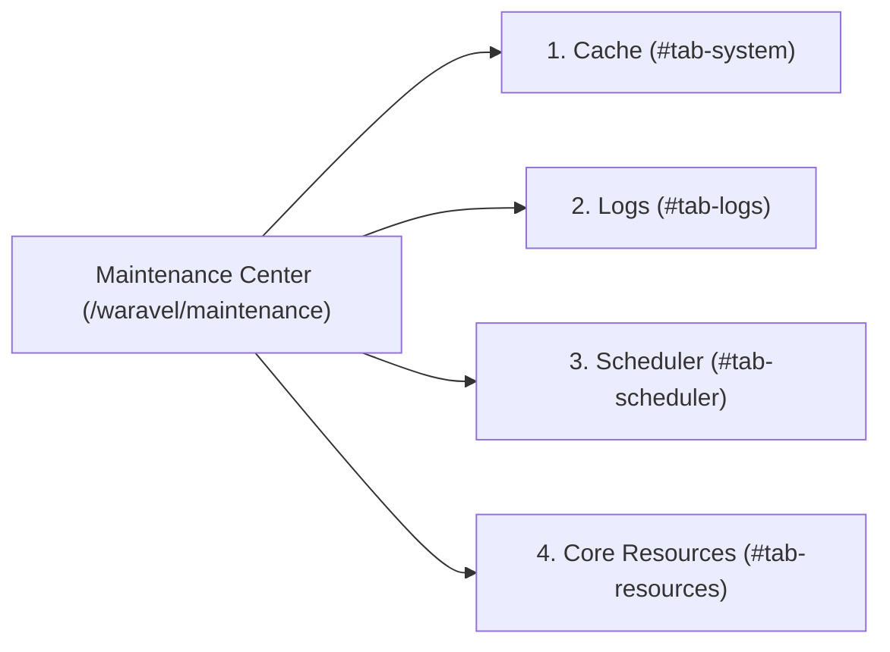

<div class="guide-banner guide-banner-user"><span>🛠️</span> User Guide: Dashboard Topbar</div>

# Maintenance Center

The **Maintenance Center** (accessible via **🛠️ Maintenance** in the Top Bar at `/waravel/maintenance`) is your global diagnostic and performance command room. 

Here, you can flush system caches, inspect live server activity without touching SSH or FTP, verify your background scheduler, and manage advanced developer overrides—all through an intuitive visual interface divided into four contextual tabs:



---

## ⚡ 1. Cache Management & Performance Optimization (`#tab-system`)

To deliver blazing sub-100ms response times, Waravel and Laravel aggressively cache configuration files, URL routing tables, and compiled Blade views. If you make an environment change or install a plugin that does not immediately reflect on screen, clearing specific cached layers provides an instant fix:

* **Config Clear (`config:clear`):** Purges cached environment variables and `config/*.php` trees. Essential after updating `.env` parameters or API credentials.
* **Route Clear (`route:clear`):** Flushes compiled route registration tables. Ideal when adding new controller endpoints or custom page paths.
* **View Clear (`view:clear`):** Clears pre-compiled Blade templates from `storage/framework/views/`, forcing templates to re-compile cleanly on next visit.
* **App Cache Clear (`cache:clear`):** Flushes application memory buffers, transient data rows, and marketplace manifest caches.
* **Global Refresh — Clear Everything (`optimize:clear`):**
  * Click the prominent red button: **Clear Everything (`optimize:clear`)**.
  * Executes a coordinated, safe all-in-one purge of all cached layers simultaneously. Recommended whenever you need a completely clean slate.

---

## 📜 2. Live System Logs (Zero FTP or SSH Required) (`#tab-logs`)

In traditional WordPress or standalone PHP setups, diagnosing a runtime warning requires opening SSH, logging into an FTP client, or digging through cPanel File Manager folders.

Waravel eliminates this complexity:
* **In-Browser Log Streaming:** The Maintenance Center streams the live tail of your `storage/logs/laravel.log` file directly into a clean, searchable terminal console.
* **Real-Time Auditing:** Watch background queue jobs execute, verify webhook deliveries, and catch runtime exceptions with detailed stack traces in real time.
* **Instant Log Clearing:** Reset bloated log files with a single click to save server disk space.

---

## 💓 3. Site Heartbeat (Scheduler Diagnostics) (`#tab-scheduler`)

Many of Waravel's automated features—including **Auto-Pilot** core updates, the **Page Generator** plugin, and scheduled future post publishing—rely on a background chronometer known as the **Site Heartbeat**.

* **Heartbeat Status Badge:**
  * Displays a green **Active** badge when healthy, or an alarming red **Inactive** pill when offline.
* **Automatic Top Bar Warning Alert (`⚠️`):**
  * If the server cron job fails to pulse for more than 5 minutes, an amber warning icon (**⚠️**) illuminates automatically next to the Maintenance link in the header.
* **Diagnostic Inspector:**
  * Click **Check Now** (`#btnCheckHeartbeat`) to run an immediate probe against `waravel_last_heartbeat` in the database.
* **cPanel Cron Setup Guide:**
  * If the Heartbeat is inactive, an integrated setup accordion provides the exact 1-minute cron command to configure in cPanel:
    ```bash
    * * * * * cd /path/to/your/project && php artisan schedule:run >> /dev/null 2>&1
    ```
* **Admin Fallback Wakeup:**
  * Even if the server cron job is temporarily halted, Waravel automatically attempts to "wake up" and process pending queue tasks whenever an administrator logs into the dashboard!

---

## 📦 4. Core Resources & Developer Overrides (`#tab-resources`)

Designed for developers, agencies, and theme authors who want to customize Waravel's internal templates without losing the ability to receive upstream core updates:

* **Extract Core Overrides (Publish):**
  * **Extract Assets (`publish-assets`):** Copies CSS, JavaScript, and branding images from the package into `public/vendor/waravel/`.
  * **Extract TinyMCE (`publish-tinymce`):** Publishes rich text editor configuration files for custom formatting plugins.
  * **Extract Config (`publish-config`):** Exposes `config/waravel.php` in your application's config folder.
  * **Extract Routes (`publish-routes`):** Exposes package routing definitions for route customization.
  * **Extract Views (`publish-views`):** Copies Blade views to `resources/views/vendor/waravel/` for deep UI customization.
  * **Force Overwrite Toggle:** Safely re-publishes assets even if local copies exist.
* **Granular Factory Reset:**
  * Made an error in an overridden template? Click **Reset** on any specific category (**Reset Configuration**, **Reset Views**, **Reset Assets**, or **Reset Routes**) to permanently delete local overrides and restore Waravel's factory core baseline.
  * Includes the **Nuclear Option: Reset EVERYTHING** for full restoration to clean defaults.
