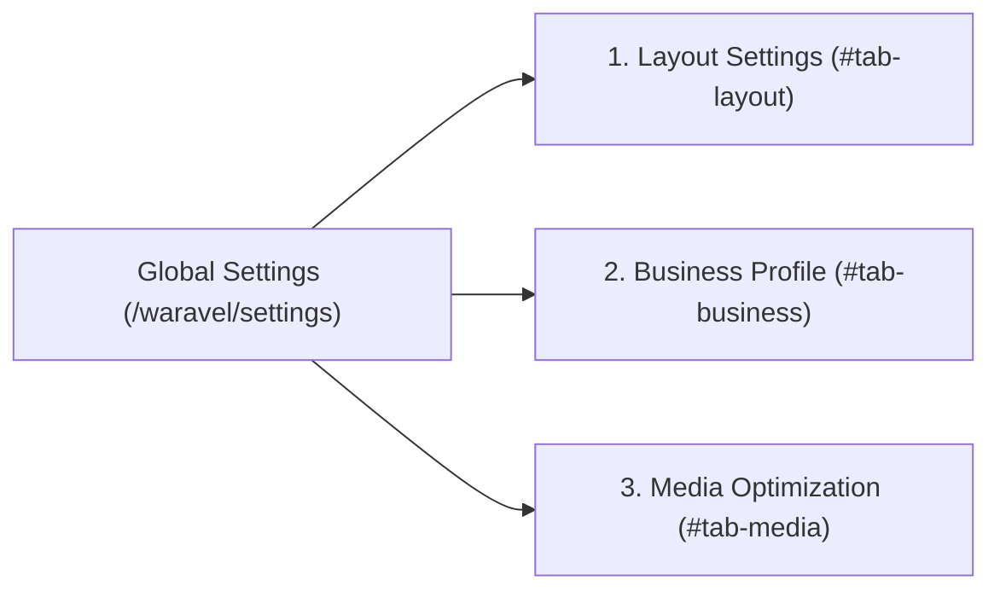

<div class="guide-banner guide-banner-user"><span>⚙️</span> User Guide: Dashboard Topbar</div>

# Global Settings

The **Global Settings** hub (**⚙️ Settings** in the Top Bar at `/waravel/settings`) is your central control room for global platform preferences, rendering architectures, business audit metadata, and automated media compression rules.

The settings panel is structured into three dedicated tabs:



---

## 🎨 1. Layout Settings & Rendering Modes (`#tab-layout`)

Controls the underlying master frame that renders your public website content:

### Rendering Modes
Waravel gives you complete architectural flexibility to switch how pages are wrapped and displayed:

1. **Blank Canvas (`waravel::layouts.canvas`):**
   * A zero-dependency fallback mode.
   * Strips away all theme logic, outer menus, and footers, providing a pure, lightweight HTML5 container. Ideal for custom sales funnels, splash pages, and headless content delivery.
2. **Laravel Layout (Standard Blade File, e.g. `layouts.base` or `layouts.app`):**
   * Integrates Waravel seamlessly into an existing native Laravel application.
   * Wraps pages inside standard Laravel Blade layout templates.
3. **Waravel Theme Layout (Widget-Aware, e.g. `theme::twenty-twenty-six.layouts.base`):**
   * Full CMS mode.
   * Automatically connects dynamic header widget zones (`@widgetZone`), customizable sidebars, footer columns, and active theme typography.

### Layout Path & Restoration Quick-Actions
* **Layout Path / Namespace:** Manually customize the view path or namespace string.
* **1-Click Restoration Buttons:**
  * **Restore to Canvas:** Instantly resets to `waravel::layouts.canvas`.
  * **Restore to Laravel Layout:** Switches back to `layouts.base`.
  * **Restore to Theme Layout:** Re-attaches the currently active theme's master layout (e.g., `theme::twenty-twenty-six.layouts.base`).

---

## 🏛️ 2. Business Profile & Audit Compliance (`#tab-business`)

The **Business Profile** tab stores vital commercial metadata required for corporate transparency, customer trust, and strict Google Ads / payment gateway audit compliance:

* **Company Name:** Your registered business or brand entity name (e.g., *Workers Direct LTD*).
* **Physical Business Address:** Your official operating premises or registered office address. Automatically populates compliance footers and structured schema tags.
* **Privacy Policy URL:** Direct link to your legal privacy documentation (default: `/privacy-policy`).
* **Terms of Service URL:** Direct link to your contractual terms (default: `/terms`).
* **Compliance Value:** Ensuring these fields are populated prevents advertising account suspensions during automated bot reviews by Google, Facebook, and merchant processors.

---

## 🖼️ 3. Media Optimization & WebP Rules (`#tab-media`)

Waravel features a native image optimization engine powered by PHP's GD extension, guaranteeing ultra-fast page speeds without requiring bulky third-party image plugins:

* **Auto-Optimize on Upload:**
  * Toggle ON to automatically resize and compress uploaded images during the intake process.
* **Responsive Sub-Size Generation:**
  * Automatically creates lightweight responsive copies for mobile devices and tablets:
    * **Generate Thumbnail:** `150x150` square crop for avatar lists and admin tables.
    * **Generate Medium:** `300x300` resolution for grid views and sidebars.
    * **Generate Large:** `1024x1024` resolution for blog hero banners.
* **Max Dimension (PX) Threshold:**
  * Protects your server storage from gigantic camera files. Images exceeding this dimension (e.g., `2560px`) are automatically downscaled proportionally while maintaining visual crispness.
* **Max Upload Size (MB):**
  * Configures the maximum file size allowed for uploads (default: `100MB`).
* **Image Quality Slider (1–100):**
  * Set the compression level for JPEG and modern WebP formats. A value of `85` delivers near-lossless visual clarity with up to 70% reduction in bandwidth consumption.
* **Pre-Flight Health Indicator:**
  * If your hosting environment lacks the native PHP GD extension, an alert box provides immediate diagnostic notice:
    ```text
    GD Extension Missing: Optimization settings will be ignored until GD is installed and active.
    ```
