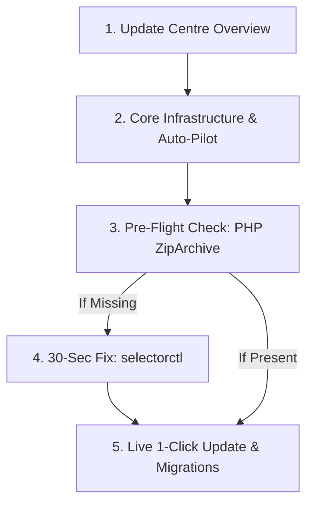

<div class="guide-banner guide-banner-user"><span>🔄</span> User Guide: System Maintenance</div>

# Waravel Updates & Health Diagnostics

The **Waravel Update Centre** (accessed via **Updates** in the top navigation bar or the left sidebar menu at `/waravel/updates`) is your unified mission control for maintaining your website’s core software, visual themes, functional plugins, and database schemas.

In Waravel, modern software delivery is completely stress-free: every update is cryptographically validated, applied atomically without downtime, and safeguarded by pre-flight environment checks.



---

## 🏛️ Scene 1: Introduction to the Update Centre

Navigating to `/waravel/updates` reveals a master status grid divided into five dedicated operational cards:

1. **Core Infrastructure:** Manages the primary Waravel engine, framework releases, and kernel dependencies.
2. **Themes:** Tracks visual theme updates and styling assets.
3. **Plugins:** Audits all installed extensions for new features and security advisories.
4. **Database Migrations:** Detects pending schema alterations, table additions, and indexing optimizations.
5. **CLI Diagnostics:** Reports the status of background scheduler queues and cron runners.

---

## ⚡ Scene 2: Core Infrastructure & Auto-Pilot Sync

The **Core Infrastructure** card (`#coreDeployBtn` container) provides real-time version intelligence and automated software delivery:

* **Installed Version vs Latest Stable:**
  * Displays your current software build alongside the latest stable release published by the Waravel engineering team.
* **Auto-Pilot Background Switch (`input[onchange*="core"]`):**
  * Toggling the **Auto-Pilot** switch activates an amber indicator glow.
  * When Auto-Pilot is enabled, Waravel's background task scheduler silently checks for verified security patches and stable maintenance updates every hour.
  * Updates are safely staged, verified, and applied in the background without requiring manual clicks or taking your website offline.
* **Semantic Release Target Selector (`#coreVersionSelector`):**
  * A flexible version dropdown selector allows you to pick specific target releases.
  * While most administrators stay on the latest stable channel, developers can easily pin specific versions or perform instant rollbacks if custom code requires legacy compatibility.

---

## 🛡️ Scene 3: Pre-Flight Security Audits & The ZipArchive Dependency

Before any code is altered on your server, Waravel's update engine runs a series of strict pre-flight security audits:

1. **Cryptographic Checksum Verification (`SHA-256`):**
   * Downloads are authenticated against official signatures to ensure files have not been tampered with or corrupted during transit.
2. **Atomic Archive Extraction:**
   * Updated files are unpacked into an isolated temporary staging directory (`storage/framework/updates/tmp/`). The live site continues serving existing files without interruption.
3. **The ZipArchive Requirement:**
   * To safely uncompress update packages, your server's PHP interpreter requires the native **`zip`** extension (`ZipArchive`).
   * On certain shared hosting environments (or freshly provisioned CloudLinux servers), this module may be disabled by default, causing pre-flight checks to pause with a warning:
     ```text
     Class "ZipArchive" not found
     ```

---

## 💻 Scene 4: 30-Second Terminal Resolution via `selectorctl`

If your server pauses due to a missing PHP `zip` extension, you can resolve it in under 30 seconds directly from your **cPanel Terminal** or an SSH terminal window using CloudLinux’s built-in `selectorctl` utility.

### Step 1: Open Terminal & Enable the Extension
In your cPanel Terminal prompt, execute the selector command targeting your active PHP version (for example, PHP 8.2):

```bash
selectorctl --interpreter php --version 8.2 --enable-user-extensions=zip
```

The system will confirm the extension has been successfully registered.

### Step 2: Verify Extension Activation
Run a quick diagnostic check to confirm that the `zip` module is active in both CLI and web environments:

```bash
php -m | grep zip
```

The terminal will immediately output:
```text
zip
```

The module is now active and ready for high-speed atomic extraction.

---

## 🚀 Scene 5: Live 1-Click Update & Database Migration

With pre-flight validation confirmed, you are ready to apply your update:

```
[ ⚡ Update to Latest Stable ]  →  Extracting  →  Clearing Caches  →  [ Run Migrations ]
```

1. **Trigger Live Update:**
   * Return to your browser window at `/waravel/updates`.
   * Click the prominent amber button: **Update Now** (`#coreDeployBtn`).
   * The button animates into a spinning progress indicator.
2. **Atomic File Deployment:**
   * Waravel downloads the verified package, verifies its SHA-256 checksum, extracts files into the core distribution directory, flushes compiled Blade view caches, and safely resets the PHP OPcache.
   * An in-DOM toast notification confirms success:
     ```text
     ✓ Waravel core successfully updated to latest version via Portal!
     ```
3. **Run Database Migrations:**
   * If the release includes new database structures or column optimizations, the **Database Migrations** card highlights with an alert badge.
   * Click the amber **Run Migrations** button (`#runMigrationsBtn`).
   * A terminal console preview logs each migration batch in real time.
4. **Final Verification:**
   * Within seconds, a green checkmark illuminates, and the Core Status badge updates permanently to a vibrant emerald: **"Up to Date"**.
   * Your platform is now operating on the fastest, most secure version of Waravel with 100% data integrity and zero visitor disruption.
